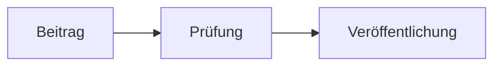
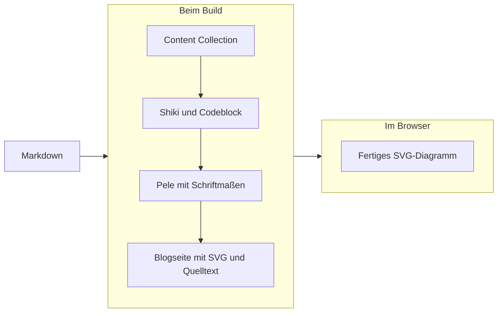
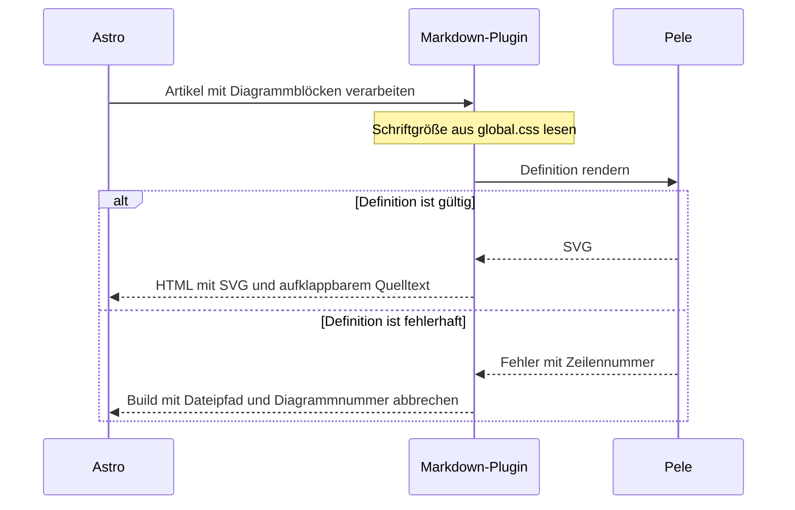
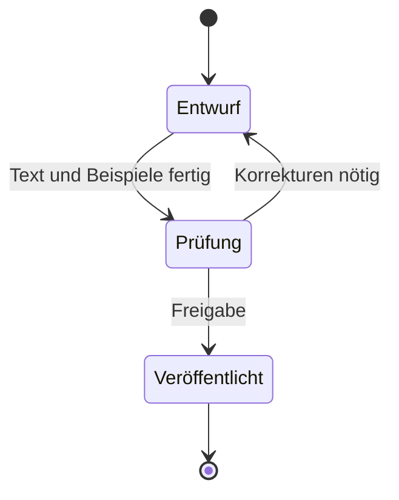
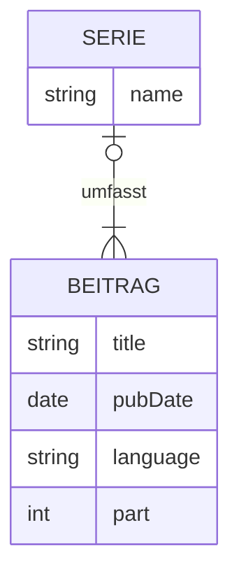
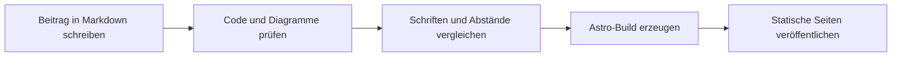

Codebeispiele zeigen einzelne Funktionen. Für die Beziehungen zwischen Komponenten
oder einen Ablauf hilft oft ein Diagramm. Mermaid erzeugt solche Diagramme aus
Text, der zusammen mit dem Artikel in Git liegt.

In [Teil 1 über Shiki und Twoslash](/blog/astro-fuer-entwicklerblogs-shiki-twoslash/)
entstanden die Codeblöcke dieses Blogs. Hier ergänze ich sie um Mermaid. Der
Quelltext bekommt dieselben Syntaxfarben, Dateititel und Copy-Buttons. Das Diagramm
übernimmt die Schriften und Farben der Website.

Die Beispiele weiter unten sind direkt gerendert. Unter jedem Diagramm lässt sich
der Quelltext aufklappen und über den Button in der Kopfzeile kopieren.

## Der Stack

| Baustein                                                                                 | Aufgabe                                                               |
| ---------------------------------------------------------------------------------------- | --------------------------------------------------------------------- |
| [Astro und Content Collections](https://docs.astro.build/en/guides/content-collections/) | Laden die Markdown-Beiträge und erzeugen beim Build statische Seiten. |
| Markdown                                                                                 | Enthält die Diagrammdefinition in einem `mermaid`-Fence.              |
| [Shiki](https://shiki.style/)                                                            | Färbt den Mermaid-Quelltext bereits beim Build ein.                   |
| [Pele 1.13.0](https://pele.run/)                                                         | Rendert die Mermaid-Syntax beim Build in Node zu einem SVG.           |
| Tailwind CSS und CSS-Tokens                                                              | Gestalten Blockrahmen, Diagramm und Quelltext passend zur Website.    |
| Sätteri                                                                                  | Ergänzt das fertige SVG in Astros Markdown-Verarbeitung.              |

Die Diagramme stehen bereits im ausgelieferten HTML. Der Browser muss keine
Diagrammbibliothek laden oder Diagramme berechnen. Auch ohne JavaScript bleiben
die SVGs sichtbar und der Quelltext lässt sich mit einem nativen `details`-Element
öffnen. Nur die Kopierfunktion benötigt JavaScript.

Astro verwendet hier den [Sätteri-Markdown-Prozessor](https://docs.astro.build/en/guides/markdown-content/#markdown-processors).
Ein HAST-Plugin ergänzt die SVGs nach dem bestehenden Shiki-Transformer.
[Pele](https://github.com/obsidianmd/pele) ist ein eigenständiger Renderer für
die Mermaid-Syntax aus dem Obsidian-Team. Er läuft direkt in Node. Beim Build ist
deshalb kein Browser nötig.

## Pele installieren und Dateien ergänzen

Die zusätzlichen Abhängigkeiten werden nur für die Entwicklung und den Build benötigt:

```sh title="Pele installieren"
pnpm add -D --save-exact pele @astrojs/markdown-satteri satteri
```

Dieser Beitrag verwendet Pele 1.13.0. Pele unterstützt die Syntax und alle
eingebauten Diagrammtypen von Mermaid 12.1.0 und hat keine Laufzeitabhängigkeiten.
Die Bibliothek ist jung und erscheint in kurzen Abständen. `--save-exact` hält
die Version deshalb fest. Ein Update wird bewusst geprüft. MDX und eine
hydratisierte UI-Komponente sind nicht nötig.

Die Diagrammverarbeitung liegt bei den bestehenden Blogdateien:

```text title="Dateien für die Mermaid-Integration"
src/
  lib/
    markdown/mermaid.ts
    markdown/code-block.ts
  components/blog/
    code-block-controls.astro
  layouts/blog-layout.astro
  styles/
    global.css
    blog.css
  i18n/translations/
    de.ts
    en.ts
```

Der Transformer erzeugt das HTML. `mermaid.ts` ergänzt die SVGs im Markdown-Prozessor.
Der Dateiname beschreibt die Syntax, nicht den Renderer.
Die Astro-Konfiguration bindet das Plugin ein. `global.css` enthält
die gemeinsamen CSS-Tokens. `blog.css` gestaltet die erzeugten Elemente und wird
nur im Bloglayout importiert. Die Kopierfunktion bleibt in `code-block-controls.astro`.

## Mermaid im vorhandenen Transformer erkennen

Ein Mermaid-Block verwendet dieselben Fence-Zusätze wie ein gewöhnlicher Codeblock:

````md title="Ein Diagramm im Markdown-Beitrag"

````

Im `root`-Hook des Shiki-Transformers steht die Sprache über `this.options.lang`
zur Verfügung. Für Mermaid verwende ich den ursprünglichen Quelltext aus
`this.source`. Zeilennummern und die erzeugten HTML-Elemente gehören nicht zur
Diagrammdefinition.

```ts title="src/lib/markdown/code-block.ts · Erkennung"
const mermaid = this.options.lang === "mermaid"
```

Der bestehende Transformer legt die Kopfzeile und den Copy-Button an. Für Mermaid
setzt er darunter einen zunächst verborgenen Diagrammbereich und ein geöffnetes
`details`-Element mit dem eingefärbten Quelltext. Als Kopiertext erhält der Button
`this.source`. Ohne Dateititel heißt die Kopfzeile "Mermaid":

```html title="Aufbau des erzeugten Diagrammblocks"
<figure class="code-block mermaid-block" data-mermaid>
  <div class="code-block-header">
    <!-- Titel und vorhandener Copy-Button mit data-copy-code -->
  </div>
  <div class="mermaid-diagram" hidden role="region" tabindex="0"></div>
  <details class="mermaid-source" open>
    <summary>Quelltext anzeigen</summary>
    <pre class="astro-code"><code><!-- Shiki-Quelltext --></code></pre>
  </details>
</figure>
```

Im tatsächlichen Markup stehen deutsche und englische Summary-Texte. CSS wählt sie
anhand von `html[lang]` aus. Damit passt die Bedienoberfläche auch ohne JavaScript
zur URL-Sprache. Die Diagrammbeschriftungen bleiben in der Sprache des Beitrags.

## Das Diagramm beim Build rendern

Die Astro-Konfiguration ergänzt das Plugin im Markdown-Prozessor:

```js title="astro.config.mjs · Einbindung"
import { defineConfig } from "astro/config"
import { satteri } from "@astrojs/markdown-satteri"
import { mermaidDiagrams } from "./src/lib/markdown/mermaid.ts"

const mermaid = mermaidDiagrams()

export default defineConfig({
  integrations: [mermaid.integration],
  markdown: {
    processor: satteri({ hastPlugins: [mermaid.plugin] })
    // Die vorhandene shikiConfig bleibt hier erhalten.
  }
})
```

Das Plugin sucht im HAST nach den vom Shiki-Transformer angelegten Diagrammblöcken.
Die ursprüngliche Definition steht direkt auf dem Zwischenknoten als HAST-Eigenschaft
`dataMermaidSource`. Das Plugin liest sie unabhängig vom Copy-Button und entfernt sie
mit `ctx.setProperty(block, "dataMermaidSource", null)` vor der HTML-Ausgabe.
Der sichtbare Quelltext und `dataCopyCode` für Copy bleiben erhalten.

Pele rendert synchron. Jeder Artikel erhält ein stabiles ID-Präfix aus seinem
Dateipfad, die einzelnen Diagramme ergänzen ihre Position im Artikel. Pele setzt
dieses Präfix über `idPrefix` vor alle IDs im SVG, auch vor Titel und
Beschreibung. Mehrere Diagramme auf einer Seite kommen sich so nicht in die Quere:

```ts title="src/lib/markdown/mermaid.ts · Rendering beim Build"
const id = `${prefix}-${index + 1}`
const { svg } = render(source, { idPrefix: id, fontSize, measurer, responsive: false })
// Das HAST-Plugin fügt dieses SVG in den zugehörigen Diagrammbereich ein.
```

Anschließend benennt das Plugin den Scrollbereich über `aria-labelledby` mit dem
SVG-Titel, zeigt das Diagramm an und klappt den Quelltext ein. Diagramme ohne
`accTitle` erhalten die übersetzte Bezeichnung „Diagramm“. Eine fehlerhafte
Definition stoppt den Build mit Dateipfad, Diagrammnummer und der Zeile aus Peles
Fehlermeldung. So wird eine kaputte Grafik vor der Veröffentlichung erkannt.

Die Collection verwendet Astros
[`deferRender: true`](https://docs.astro.build/en/reference/content-loader-reference/#deferrender).
Dadurch läuft die Markdown-Verarbeitung beim Rendern der Seite durch Vite.
Die Integration registriert `global.css` und das Plugin selbst mit `addWatchFile`.
Ändert sich die Schriftgröße, löst das einen Neustart der Konfiguration aus. So
bleiben im Devserver keine SVGs mit veralteten Maßen im Inhaltscache erhalten.
Beim Produktionsbuild entsteht weiterhin vollständiges statisches HTML.

Die Definition bleibt am Copy-Button erhalten. Das SVG ersetzt den Quelltext nicht.
Auch nach dem Rendern lässt sich die Definition mit dem nativen `details`-Element
öffnen, lesen und kopieren.

## Diagramme wie die Website gestalten

### Farben und Schriften übernehmen

Pele schreibt keine festen Farben ins SVG. Flächen, Linien und Texte verweisen
auf CSS-Variablen wie `--pele-fg` oder `--pele-surface`. Mermaid-Themes und
`themeVariables` braucht es deshalb nicht. Die
[Pele-Dokumentation zum Theming](https://pele.run/theming) listet alle Variablen.

`blog.css` ordnet sie den bestehenden CSS-Tokens zu:

```css title="src/styles/blog.css · Diagrammfarben"
.mermaid-diagram > .pele {
  --pele-font: var(--font-mono);
  --pele-font-mono: var(--font-mono);
  --pele-bg: var(--color-code);
  --pele-fg: var(--color-ink);
  --pele-muted: var(--color-muted);
  --pele-line: var(--color-muted);
  --pele-border: var(--color-muted);
  --pele-surface: var(--color-paper);
  --pele-surface-alt: var(--color-code);
  --pele-accent: var(--color-ink);
}
```

| CSS-Token       | Aufgabe im Diagramm                                       |
| --------------- | --------------------------------------------------------- |
| `--color-paper` | Helle Knoten, Akteure und Tabellen                        |
| `--color-ink`   | Beschriftungen und Hervorhebungen                         |
| `--color-muted` | Pfeile, Linien und Knotenränder                           |
| `--color-code`  | Hintergrund, Gruppenflächen und Flächen hinter Kantentext |
| `--font-mono`   | JetBrains Mono für Diagrammbeschriftungen                 |

So bleibt die Website die Quelle der Farben. Weil der Browser die Variablen erst
beim Anzeigen auflöst, wirkt eine Änderung an den Tokens ohne neues Rendering.
Hex-Werte sind nicht mehr nötig. Der Codeblock-Hintergrund steht weiterhin mit
`@theme static` in `global.css`. So bleibt er im erzeugten CSS erhalten, obwohl
keine Utility-Klasse ihn verwendet.

### Beschriftungen ohne Browser ausmessen

Für Knotenbreiten und Zeilenumbrüche muss Pele wissen, wie breit ein Text ist.
Im Browser misst Pele über ein Canvas, in Node schätzt es die Breite mit einer
eingebauten Tabelle. Die Diagramme dieses Blogs verwenden JetBrains Mono. In
dieser Schrift ist jedes Zeichen 0,6 em breit, in allen Schnitten. Ein eigener
Messer kommt deshalb ohne Schriftdatei aus:

```ts title="src/lib/markdown/mermaid.ts · Textbreiten"
const measurer = { width: (text: string, size: number) => [...text].length * size * 0.6 }
```

Die Schriftgröße liest das Plugin aus dem Token `--text-code` in `global.css`:
hier 0,875 rem, also 14 Pixel. Pele berechnet Knoten und Abstände bereits mit
dieser Größe. Eine nachträgliche Änderung im CSS würde die Texte dagegen
verkleinern, ohne das Layout neu zu berechnen.

Pele erzeugt Beschriftungen immer als SVG-Text. Beliebiges HTML in Labels
unterstützt es nicht, nur einige Inline-Tags wie `<b>`, `<code>` oder `<br>`.
Damit wirken die allgemeinen Markdown-Styles nicht auf ein Diagramm.
JavaScript-Callbacks in `click`-Anweisungen ignoriert Pele.

### Den Block und die mobile Darstellung abstimmen

Der äußere Rahmen verwendet `.code-block`, die neue Diagrammfläche ergänzt nur
Innenabstand und einen lokalen Scrollbereich:

```css title="src/styles/blog.css · Diagrammfläche"
.mermaid-diagram {
  overflow-x: auto;
  padding: 1rem;
}

.mermaid-diagram > svg {
  display: block;
  height: auto;
  margin-inline: auto;
}
```

Mit `responsive: false` setzt Pele die natürliche Breite und Höhe am SVG. CSS
übernimmt diese Größe und zentriert das Diagramm. Dadurch bleibt auch die
14 Pixel große Schrift erhalten. Breitere Diagramme scrollen innerhalb des
Blocks. Peles eigene Anpassung an die Containerbreite bräuchte JavaScript im
Browser und bleibt hier ungenutzt.

Der Scrollbereich ist per Tab erreichbar und über den zugänglichen Diagrammtitel
benannt. Der Quelltext-Schalter verwendet dieselben Abstände und Farben wie die
Codeblock-Kopfzeile. Diagrammbeschriftungen, Code und Titel verwenden JetBrains Mono.

## Diagramme ausprobieren

Alle folgenden Definitionen enthalten `accTitle` und `accDescr`. Pele erzeugt
daraus Titel, Beschreibung und ARIA-Verweise im SVG. Der Fließtext erklärt den
Inhalt zusätzlich. Siehe [Mermaids Barrierefreiheitsoptionen](https://mermaid.js.org/config/accessibility.html).

### Flowchart für den Blog-Stack

Astro verarbeitet den Beitrag beim Build. Shiki erzeugt den Quelltextblock,
anschließend ergänzt Pele das fertige SVG:



Dieser Block prüft Gruppen, Pfeile und mehrzeilige Abläufe. Beim Kopieren dürfen
die eingeblendeten Zeilennummern nicht in der Definition stehen.

### Sequenzdiagramm für das Rendering

Das Markdown-Plugin erzeugt die Grafik vor der Veröffentlichung. Eine ungültige
Definition bricht den Build ab:



Hier lassen sich die Farben von Akteuren, Nachrichten, Notizen und alternativen
Abläufen vergleichen. Auch diese Flächen sollen zur Website passen.

### Zustandsdiagramm für die Veröffentlichung

Ein Beitrag kann zwischen Entwurf und Prüfung wechseln, bevor er veröffentlicht
wird. Das Diagramm beschreibt den redaktionellen Ablauf, nicht zusätzliche
Funktionen der Content Collection:



Dieser Block prüft Zustandsknoten, Start- und Endmarkierungen sowie Umlaute in
Beschriftungen.

### ER-Diagramm für Serie und Beiträge

Das Collection-Schema enthält ein optionales Serienobjekt mit Name und Teilnummer.
Das folgende Modell zeigt diese Beziehung. Es beschreibt keine zusätzliche
Datenbank im Blog:



Die Tabellenköpfe und Attributzeilen des ER-Diagramms müssen ebenfalls die
hellen Töne der Website verwenden. Die Beziehungslinien bleiben deutlich sichtbar.

### Ein breites Diagramm auf dem Smartphone

Dieser längere Ablauf ist absichtlich horizontal angeordnet. Auf einem schmalen
Display sollte nur die Diagrammfläche seitlich scrollen:



## Die Funktionen prüfen

- **Quelltext öffnen und kopieren.** Die Definition muss vollständig bleiben,
  einschließlich Leerzeilen und `accDescr`. Dateititel und Zeilennummern gehören
  nicht zum kopierten Text.
- **Mehrere Diagramme ansehen.** Jedes SVG braucht eigene IDs. Pfeile und
  Beschriftungen dürfen sich nicht auf ein anderes Diagramm beziehen.
- **Mit der Tastatur bedienen.** Tab erreicht den Copy-Button, den Scrollbereich
  und den Quelltext-Schalter. Enter öffnet den Quelltext.
- **Auf schmalen Displays lesen.** Die Seite bleibt innerhalb der Fensterbreite.
  Breite Diagramme haben einen eigenen Scrollbereich.
- **Ohne JavaScript lesen.** Das SVG ist sofort sichtbar. Der Quelltext lässt
  sich weiterhin öffnen und lesen.
- **Fehler behandeln.** Eine ungültige Definition muss den Build mit Dateipfad
  und Diagrammnummer abbrechen.

Für den letzten Fall eignet sich eine temporäre Testdefinition:

````md title="Fehlerfall für einen lokalen Testartikel"
```mermaid title="Absichtlich ungültig"
flowchart TD
  A -->
```
````

Die ungültige Definition oben wird hier als Markdown-Beispiel gezeigt. Die fünf
Diagramme dieses Artikels sind gültige Beispiele. Die Integration wird zusätzlich
mit den vorhandenen Projektprüfungen verifiziert:

```sh title="Projekt prüfen"
pnpm validate
```

## Nachtrag: weniger JavaScript durch fertige SVGs

Die erste Fassung dieses Artikels renderte Mermaid im Browser. Ein späterer Blick
auf den Produktionsbuild zeigte, dass der Artikel dafür rund 2,43 MB JavaScript
lud, etwa 712 kB nach gzip-Kompression. Dazu gehörte auch die ELK-Layoutbibliothek.
Die großen Chunks betrafen also den fertigen Build.

Deshalb entstehen die SVGs inzwischen beim Build. Mermaid und ELK werden nicht
mehr an Besucher ausgeliefert. Die Diagramme behalten ihre Gestaltung und sind
auch ohne JavaScript sichtbar.

## Nachtrag: Pele statt Mermaid.js

Das Rendering beim Build lief zunächst weiter mit Mermaid.js. Mermaid braucht
zum Ausmessen der Beschriftungen einen Browser. Deshalb startete der Build für
jeden Artikel mit Diagrammen ein Chromium über Playwright, lud die Schrift als
Data-URL und las die Farben aus berechneten Styles. Auf dem Buildserver musste
Chromium vor jedem Build installiert werden.

Seit November 2026 rendert Pele die Diagramme direkt in Node. Die Mermaid-Syntax
in den Artikeln bleibt unverändert. Damit entfallen Chromium im Build, die
Übergabe der Farben als Hex-Werte und das nachträgliche Umbenennen von IDs.
Die fünf SVGs dieses Artikels sind zusammen rund 22 kB statt 128 kB groß.
Pele verwendet ein eigenes Layout. Knoten und Pfeile liegen daher etwas anders
als mit Mermaids ELK-Layout. Dieser Artikel und seine Beispiele beschreiben
bereits die Umsetzung mit Pele.
